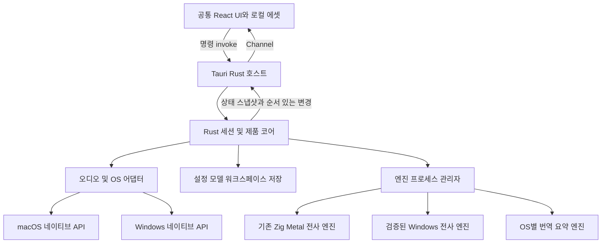

# Madi Tauri 마이그레이션 계획

작성일: 2026-11-04. 조사 기준: `c1390c750f2506e556a277421e146d80195ab797`.
상태: 자율 구현 진행 중. 현재 증거와 남은 항목은 [진행 현황](TAURI_MIGRATION_STATUS.md)에 기록한다.
아래 기간과 성능 수치는 추정 및 검증 목표이며 측정 결과가 아니다.

현재 Madi의 UI와 UX를 유지하면서 macOS와 Windows에서 실행하는 공통 데스크톱 앱을 만든다.
사용자가 확정한 우선순위는 **macOS·Windows 우선**이다. Linux는 이후 단계로 둔다.
권장 구조는 **Tauri 2 + React/TypeScript 화면 + Rust 제품 코어 + OS별 어댑터 + 기존 추론 엔진 프로세스**다.
Tauri의 Rust 부분은 창·시스템 기능·제품 상태를 담당하고 화면은 HTML/CSS로 재구현한다.
SwiftUI를 자동 변환하거나 현재 웹 대시보드를 그대로 제품 UI로 채택하는 작업이 아니다.

## 1. 완료 조건과 범위

- 기준 앱과 같은 화면 구성, 문구, 색상, 아이콘, 타이포그래피, 간격, 줄바꿈, 상태 표시를 제공한다.
- 클릭 순서, 포커스, 키보드 조작, 스크롤 추적, 편집·취소, 파일 드롭, 창 전환, 오류 복구가 같은 결과를 만든다.
- 번역·요약·Q&A를 포함해 기준 제품에서 노출되는 기능이 양쪽 OS에서 실제로 동작해야 한다.
- 기존 설정, 모델, 회의 파일과 내보내기 결과를 보존한다. 클라우드 추론·계정·원격 텔레메트리를 추가하지 않는다.
- 기준 제품에서 꺼진 기능은 동일하게 꺼진 상태를 유지한다. 기능 복원·리디자인·저장 형식 개편은 별도 작업이다.
- macOS 14 이상 Apple Silicon과 Windows 11 x64를 초기 검증 대상으로 제안한다. 정확한 OS 버전·CPU·GPU·메모리 지원표는 G1에서 확정한다. Intel Mac, Windows ARM64와 Linux 지원은 이번 완료 조건에 포함하지 않는다.

**동일성의 기술적 한계도 선행 검증 대상이다.** Tauri는 macOS에서 WKWebView, Windows에서 WebView2를 사용하므로 동일한 CSS가 동일한 픽셀을 보장하지 않는다.[¹](https://v2.tauri.app/reference/webview-versions/)
시스템 폰트, 글자 안티앨리어싱, 창 장식, 파일 선택 창과 OS 권한 창까지 현재 macOS와 픽셀 단위로 같아야 한다면 이 요구를 그대로 충족한다고 약속할 수 없다.
G0에서 실제 비교본과 차이 목록을 만들고 해결 가능 여부를 판단한다. 승인되지 않은 차이는 완료를 막는 항목이며, 자동으로 예외 처리하지 않는다.
Windows의 Ctrl 대응, Finder/Explorer 표기처럼 플랫폼에 따른 조작·문구 차이도 이 목록에 포함한다.

## 2. 현재 코드에서 확인한 출발점

| 영역 | 확인된 상태 | 계획에 주는 영향 |
|---|---|---|
| 제품 UI | `apps/macos/Sovereign/UI/`와 `SovereignApp.swift`의 SwiftUI/AppKit | 현재 실행 앱과 해당 커밋의 구현을 기준으로 화면을 재구현한다. |
| 디자인 | `Theme.swift`는 수동 관리이며 `tokens.json`과 차이가 있다. `gen_theme.py`는 오래된 `app/…` 경로를 사용한다. | 기존 생성기를 실행하지 않는다. 실제 Theme와 뷰의 상수를 대조해 토큰을 복구한다. |
| 창 크기 | `ContentView.applyWindowMode`가 초기 선언을 덮어쓴다. 기본 목표 1150×710, 시작 화면 최소 980×640, 작업 화면 최소 760×520 | `defaultSize(500, 900)` 또는 오래된 SVG만 보고 치수를 정하지 않는다. 화면 크기에 따른 실제 동작도 캡처한다. |
| 웹 코드 | `web/dashboard`는 React/Vite 기반 분석용 scaffold | 타입·fixture·일부 계산을 검토해 재사용하되 화면 구조는 재사용하지 않는다. |
| 엔진 연결 | `EngineProcess`가 stdin/stdout 텍스트와 `EVENTS_FILE` JSONL을 함께 처리 | 두 입력을 모두 Rust 어댑터에서 정규화한다. JSONL만으로 초기 이식을 끝내지 않는다. |
| 세션 수명 | `SessionCoordinator`, `SessionArchiveWriter`, `SessionOneShotTranscriber`와 회귀 테스트가 분리되어 있다. | 기존 계약과 실패 사례를 Rust 이식의 실행 가능한 기준으로 사용한다. |
| macOS 오디오 | AVAudioEngine, ScreenCaptureKit, AVAudioConverter | 얇은 macOS 네이티브 어댑터로 유지하고 Rust 코어와 분리한다. |
| Windows 전사 | `engine/cuda`에 `nvcuda.dll`을 사용하는 코드가 있으나 기존 계획상 제품 통합 전 | 빌드·프로토콜·화자 분리·실시간 성능을 먼저 입증해야 한다. |
| 번역·요약 | `engine/prebuilt`는 macOS arm64용 별도 라이선스 바이너리이고 원본 소스는 이 저장소에 없다. | Windows용 동등 엔진 확보가 주요 선행 의존성이다. Tauri로 감싸도 해결되지 않는다. |
| 저장 | Markdown 회의 파일·동반 요약, UserDefaults, Application Support의 모델·데이터 | 기존 경로와 설정을 조사하고 비파괴 마이그레이션을 만든다. |
| 기능 노출 | 받아쓰기, 보이스프린트, 편집 분석은 플래그로 꺼져 있다. 실시간 요약은 기본 비활성 실험 설정이 있다. | 소스에 존재하는 기능과 실제 제품에 노출되는 기능을 구분한다. 기본값과 기존 사용자 설정을 모두 보존한다. |

관련 근거: [macOS 앱 구조](../apps/macos/README.md), [현재 Theme](../apps/macos/Sovereign/UI/Theme.swift), [창과 화면](../apps/macos/Sovereign/UI/ContentView.swift), [세션 계약](SESSION_LIFECYCLE.md), [엔진 이벤트](EVENTS.md), [번역 엔진 출처](../engine/prebuilt/README.md), [기존 크로스플랫폼 계획](CROSS_PLATFORM.md).
README와 디자인 시안보다 실제 구현·설정·실행 결과가 우선한다. 현재 체크아웃이 사용자가 기준으로 삼는 배포본과 같은지는 G0에서 버전과 실행 파일 해시로 대조한다.

## 3. 목표 구조와 책임



| 경계 | 소유하는 책임 |
|---|---|
| React UI | 화면, 선택·편집 중 임시 상태, 키보드 포커스, 스크롤 위치, 공통 컴포넌트와 접근성 |
| Rust 코어 | 세션 상태, 전사 병합·화자 정정, 번역 큐·오래된 응답 배제, 요약·Q&A 정책, 저장·내보내기 |
| Tauri 호스트 | 창·메뉴·IPC·배포 연결. 업무 규칙은 코어로 위임 |
| 플랫폼 어댑터 | 오디오 장치·캡처·디코딩, 권한, 파일 선택, 캘린더, 화면 목록과 비활성 자막 창 |
| 엔진 관리자 | 실행 파일·모델 선택, stdin/stdout, 종료·재시작·타임아웃, 버전·해시·기능 호환성 |

Rust만 영속 제품 상태의 정본을 갖는다. React는 버전이 붙은 표시 스냅샷을 구독하고, 사용자 명령으로 변경을 요청한다.
TS와 Rust 양쪽에 별도 세션 정책을 만들지 않는다. UI 작업 때문에 추론 엔진을 Rust로 다시 작성하지 않는다.
기존 Swift 제품 로직은 기능 단위로 Rust에 옮기고, macOS 시스템 API 연결에 필요한 작은 Swift/ObjC 브리지만 남길 수 있다.

제안 디렉터리:

```text
apps/desktop/
  src/                    # React 화면, 컴포넌트, UI 상태
  src-tauri/              # Tauri 호스트, capabilities, 패키징
crates/
  madi-core/              # 세션, 전사, 번역 정책, 저장
  madi-protocol/          # 엔진 parser, UI DTO 및 버전 계약
  madi-platform/          # macOS/Windows 구현과 공통 인터페이스
design/parity/            # 화면 목록, 기준 캡처, 조작 시나리오, 차이 기록
tests/parity/             # Swift/Rust 공통 fixture와 UI 검증
```

`apps/desktop`, `madi-protocol`, `madi-core`의 초기 구현을 시작했다. 나머지는 제안 구조다.
기존 `apps/macos`는 전환이 끝날 때까지 비교 기준과 복귀 경로로 유지한다.

### 엔진과 UI 통신 계약

- 기존 stdout 문법은 유지한다. `READY`, `SPK/SPKFIX/SPKOV`, segment/flush 경계와 EOF 처리에 대한 Swift 테스트를 Rust에 대응시킨다.
- `EngineProcess`의 JSONL 읽기 시점과 stdout barrier 순서까지 재현한다. 두 입력에 중복된 word/segment가 있어도 두 번 반영하지 않도록 이벤트별 정본을 명시한다.
- 내부 UI envelope를 `schemaVersion`, `sessionId`, `generation`, `seq`, `revision`, `type`, `payload`로 버전화한다. 내부 계약이며 기존 엔진 출력을 변경하는 요구가 아니다.
- 명령은 시작·일시정지·재개·정지·가져오기·편집·내보내기 등으로 제한한다. 중복 정지, 늦은 응답, 취소된 가져오기가 새 세션을 변경하지 못하게 한다.
- 재구독은 스냅샷과 마지막 `seq`를 원자적으로 제공한 뒤 그 이후 변경을 전달한다. 순서 누락 시 다시 스냅샷을 요청한다.
- 전사·진행률은 순서를 보장하는 Tauri Channel을 사용한다. 원시 PCM은 Rust/네이티브 캡처 경로에 남기고 WebView로 보내지 않는다.[²](https://v2.tauri.app/develop/calling-frontend/)
- 화면 전달 빈도와 큐를 제한한다. meter/중간 표시만 합칠 수 있고 확정 전사·편집·오류·완료 이벤트는 버리지 않는다. 느린 UI가 오디오 콜백을 막지 않도록 한다.
- 세션 시작과 flush의 기존 45초 deadline, capture tail을 보낸 뒤 FLUSH, 종료 전 stdout drain, 완료 한 번만 수행하는 계약을 보존한다.

### OS 연결

macOS는 기존 AVAudioEngine/ScreenCaptureKit 캡처를 먼저 유지한다. 네이티브 브리지의 버퍼 소유권·스레드·취소 규칙을 고정하고, 실제 서명된 앱에서 마이크·시스템 오디오 권한을 검증한다.
Windows는 WASAPI 입력 캡처와 shared-mode loopback을 사용한다. loopback은 출력 장치의 재생 스트림을 받을 수 있지만 일반 마이크 라이브러리만으로 그 기능을 대체했다고 간주하지 않는다.[³](https://learn.microsoft.com/en-gb/windows/win32/coreaudio/loopback-recording)
두 OS 모두 16 kHz mono PCM 계약, 마이크+시스템 혼합, 장치 변경·분리, silence, flush tail을 시험한다. Windows에서는 서로 다른 장치 clock drift와 앱 자체 재생음의 재캡처도 별도 확인한다.

파일 가져오기는 현재 허용 확장자·코덱 corpus와 비교한다. Windows 디코더는 Media Foundation 등 네이티브 경로를 우선 검증하고, 지원 공백이 있으면 동봉 디코더를 별도 검토한다. 사용자가 개발 도구나 ffmpeg를 설치해야만 동작하는 구조는 피한다.
캡션 창의 always-on-top, 포커스를 빼앗지 않는 동작, 전체 화면·다중 모니터·DPI 전환은 Tauri 설정만으로 충족한다고 가정하지 않고 플랫폼 구현을 검증한다.
EventKit 캘린더의 Windows 대응은 로컬 일정 공급자와 사용자 승인 흐름을 G1에서 검증한다. 이를 위해 클라우드 계정 연결을 새로 요구하거나 기능을 숨기는 것을 동등 구현으로 처리하지 않는다.

## 4. UI와 UX 동일성 검증

G0 산출물은 `화면 × 상태 × 조작 × 기대 결과` 목록이다. 기준 캡처에는 앱 버전·커밋·제품 변형·언어·테마·해상도·배율·모델 상태를 기록한다.
일반 제품과 source-only 빌드는 서로 다른 기준 묶음으로 취급한다. 번역 엔진이 없는 Windows 앱을 source-only 기준과만 비교해 일반 제품 이식을 완료 처리하지 않는다.

| 화면 묶음 | 포함해야 할 상태와 동작 |
|---|---|
| 첫 실행·시작 | 모델 선택·다운로드·검증·취소·실패·재시도, 기존 모델 감지, 언어·입력원·화자 선택, 파일 staging, 최근 항목 |
| 녹음·파일 전사 | countdown, 준비, 녹음, 일시정지, 처리, flush, 완료, 오류, 레벨 표시와 시작/정지 확인 |
| 전사 본문 | 내용/상세/조건부 대화 모드, partial→확정, 화자 정정, 번역 대기·완료, 폰트 크기, 찾기, 본문 수정·취소 |
| 스크롤·선택 | 자동 따라가기, 사용자가 위로 스크롤한 상태, 새 문장 도착, 긴 기록의 선택·복사·검색 이동, IME 조합 |
| 저장·워크스페이스 | 자동 저장·실패·재시도, 저장 toast, 트리 정렬·확장, 열기·이름 변경, 요약 동반 파일, 실제 노출 export |
| AI·보조 화면 | 요약·Q&A·회의 모드 및 현재 도달 가능한 보조 화면, 캡션 창, 설정·모델 관리·정보·업데이트·오프라인 도움말 |
| 숨김·조건부 기능 | feature flag, 메모리·모델·화자 수에 따른 노출 조건, beta 상태, 기존 설정이 남은 업그레이드 설치 |

토큰은 실제 `Theme.swift`의 light/dark 값과 뷰 안의 상수를 먼저 추출한다. 보정된 토큰에서 CSS와 Swift 검증용 값을 생성하고, 기존 SwiftUI 캡처가 달라지지 않는지 확인한 뒤 생성 경로를 전환한다.
기존 SVG·로고를 우선 재사용한다. OS 기본 HTML button/select 스타일은 배제하고 Madi 모양과 키보드·접근성 동작을 갖춘 공통 컴포넌트를 만든다.
한국어·영어·일본어 문구와 fallback도 기존 동작을 유지한다. 한국어/일본어 IME, Unicode grapheme 경계, 혼합 언어 줄바꿈을 포함한다.

폰트는 별도 G0 항목이다. 현재 시스템·rounded·monospaced 폰트와 CJK fallback을 식별하고 Windows 사용·배포 가능성을 확인한다. Apple이 제공하는 폰트가 Windows 배포 권한까지 의미한다고 가정하지 않는다.[⁴](https://developer.apple.com/fonts/)
대체 폰트·대체 아이콘은 동일 구현으로 자동 승인하지 않는다. 글리프·행간·줄바꿈이 달라지면 요구 충족 여부를 별도로 결정해야 한다.

검증 원칙:

1. 같은 fixture, 가상 시계, 창 크기, 테마와 언어로 SwiftUI와 Tauri를 비교한다. caret·시계·오디오 meter 등은 값을 고정해 캡처하고 동적 동작은 별도 시나리오로 검증한다.
2. macOS 1×/2×와 Windows 100/125/150/200% 배율에서 실제 앱을 검사한다. 기준/최소 크기와 지원 화면의 최대화·다중 모니터 이동을 포함한다.
3. 레이아웃·문구·아이콘·표시 조건·줄바꿈 차이는 실패다. 글자 rasterization의 작은 차이도 먼저 기록하며, 승인된 좁은 비교 규칙만 적용한다. 전역 오차율로 UI 차이를 숨기지 않는다.
4. 조작 시나리오는 100% 통과해야 한다. 스크린샷만으로 포커스·스크롤·취소·오류 복구의 동등성을 선언하지 않는다.
5. 브라우저 테스트와 실제 Tauri 앱 테스트를 구분한다. 현재 Tauri 공식 문서는 `@wdio/tauri-service` embedded driver의 macOS 지원을 안내한다. 직접 `tauri-driver`를 구동하는 방식은 Windows/Linux 경로다. G0에서 사용할 버전을 고정하고 양쪽 실제 앱의 캡처와 조작을 입증한다.[⁵](https://v2.tauri.app/develop/tests/webdriver/)
6. 테스트 전용 embedded driver·mock·디버그 명령은 배포 앱에서 제외한다. OS 권한 창과 실제 오디오·전체 화면 캡션은 네이티브 조작 또는 실기기 확인도 필요하다.

## 5. 단계와 통과 기준

단계별 결과를 작은 PR로 병합한다. 화면, 프로토콜, 오디오, 제품 로직을 한 번에 전환하지 않는다.
Windows 엔진·폰트·캡션·캘린더 검증은 초기에 시작하며 macOS 이식이 끝날 때까지 미루지 않는다.

| 단계 | 작업과 산출물 | 다음 단계 통과 기준 |
|---|---|---|
| G0 기준 고정 | 기준 배포본/커밋, reachable 화면·flag 목록, 캡처·조작 fixture, 토큰 차이, 양 OS 대표 화면·폰트·IME 검증 | 비교 기준 확정. 미해결 동일성 항목과 해결 경로가 기록됨. 해결 불가능 항목이 있으면 범위 결정 전 완료 약속 금지 |
| G1 호환성 검증 | Tauri 최소 셸, Rust 프로토콜 실험, macOS 기존 엔진 실행, Windows 실제 음성 전사·번역·요약, loopback·캡션·캘린더 PoC | Windows 일반 제품 기능에 필요한 실행 파일·모델·지원 하드웨어 확인. 모의 엔진·캡처 없는 화면 데모는 통과 근거가 아님 |
| G2 화면 이식 | 공통 토큰·에셋, 시작·모델 화면 → 본문·녹음 제어 → 설정·워크스페이스 → AI·보조 창 순서. fixture로 모든 상태 구현 | 기준 UI·UX 시나리오 통과, 양 OS 화면 비교. 제품 동작 완료와는 구분 |
| G3 macOS 제품 코어 | 세션/전사 → 저장·export → 번역·요약/Q&A 정책을 Rust로 이식. 기존 Metal/LLM 및 네이티브 캡처 연결 | Swift/Rust 차등 테스트, macOS 실제 end-to-end, 데이터 마이그레이션·복귀, 기준 대비 지연·메모리 검증 |
| G4 Windows 제품 통합 | G1에서 검증한 엔진·오디오·파일 디코더·OS 어댑터를 공통 코어에 통합. 일반 제품 기능 전체 연결 | 지원표의 실제 장비에서 전 기능·품질·장시간 실행·UI 동등성 통과 |
| G5 배포 전환 | 서명·설치·업데이트·WebView 준비, 별도 시험 채널, 새 설치/기존 설치 업그레이드/복귀 검증 | 미승인 UI·UX 차이 0건, 데이터 손실 0건, 일반 제품 엔진 포함 검사, 실기기 검증 완료 후 기본 배포 전환 |

G2와 G3 일부, G4 플랫폼 작업은 계약이 확정된 뒤 병행할 수 있다. G1 Windows 의존성이 미해결이면 macOS 이식을 진행할 수 있으나 양 OS 마이그레이션 완료로 보고하지 않는다.

첫 PR 묶음은 다음처럼 나눈다.

1. 기준 버전·기능 노출·화면/조작 목록과 재현 fixture.
2. 양 OS Tauri 셸·실제 앱 테스트 도구·대표 화면 재현. 배포 전용 설정 분리.
3. 토큰 정합화와 기존 화면 불변 검증, CSS 생성.
4. 엔진 프로토콜 Rust parser와 Swift 차등 corpus.
5. Windows 엔진·오디오·캡션·캘린더 검증 결과와 지원표. 필요한 엔진 수정은 별도 PR.
6. UI 화면 묶음별 PR과 세션/저장/AI 코어별 PR. 각 PR에 기준 캡처 또는 동작 증거 첨부.
7. 설치·설정 이관·업데이트 전환과 release-candidate 검증.

## 6. 데이터 보존과 배포

macOS에서 `~/Library/Application Support/Madi/`, 실제 UserDefaults 도메인, 사용자 지정 저장 폴더, 모델 해시, 숨김 설정을 목록화한다.
Windows의 앱 데이터는 `%LOCALAPPDATA%/Madi/`를 기본 제안으로 두고 사용자가 선택한 회의 폴더는 그대로 존중한다.
기존 Markdown과 동반 요약은 그대로 읽고 쓴다. 현재 Markdown이 원래 저장하지 않는 word timing·ID까지 복원된다고 주장하지 않는다.

설정 이관은 백업 → 읽기 → 검증 → 원자적 반영 → 완료 마커 순서로 진행하고 반복 실행해도 같은 결과가 되도록 한다.
기존 모델은 해시가 맞으면 재사용한다. 실험 중 새/구 앱의 설정은 분리하고 동일 워크스페이스의 동시 쓰기를 막는다.
Windows 경로 구분자·예약 파일명·한글/일본어 이름·대소문자·긴 경로·임시 파일 삭제·rename 실패를 시험한다.
Rust 직렬화는 기존 Swift JSON/날짜/숫자/화자 식별 규칙과 fixture로 대조한다.

엔진은 OS/아키텍처별 sidecar로 패키징하고 모델·프로토콜·해시·라이선스 manifest를 갖춘다. Tauri는 target별 외부 실행 파일 동봉을 지원한다.[⁶](https://v2.tauri.app/develop/sidecar/)
macOS는 기존 엔진의 framework·metallib·에셋 검색 경로를 함께 보존하고 전체 번들의 서명·notarization·DMG를 검증한다.
Windows는 서명된 설치 프로그램, WebView2 설치/오프라인 준비, 엔진 `.exe`와 런타임 의존성, 일반 사용자 권한 설치를 검증한다.
GPU 드라이버와 엔진 VRAM/RAM 요구를 지원표로 관리한다. NVIDIA 없는 장비의 대안은 실측 전에 지원한다고 표기하지 않는다.

기존 `UpdateChecker`의 stable/beta/rc feed, 버전 비교, 다운로드·검증·설치 UI를 유지할 어댑터를 먼저 만든다.
Tauri updater 도입 여부는 기존 배포 경로의 호환성 검증 후 결정하며, 업데이트 버튼의 동작을 이식과 동시에 임의 변경하지 않는다.
전환은 별도 시험 채널 → 실사용 검증 → 기본 채널 순서로 진행한다. 이전 앱으로 복귀해도 기존 파일을 열 수 있어야 하며, 새 형식의 강제 변환은 넣지 않는다.

WebView에는 동봉 UI만 로드한다. 파일·프로세스·권한은 Rust의 좁은 명령으로 노출하고 입력 경로를 검증한다.
전사/Markdown/LLM 출력은 신뢰하지 않는 텍스트로 렌더링한다. 광범위 shell/fs 권한이나 remote origin 권한을 주지 않는다.
창별 capability를 분리하고 자막 창에는 필요한 읽기 기능만 부여한다. capability만으로 앱의 사용자 정의 명령 검증을 대체하지 않는다.[⁷](https://v2.tauri.app/security/capabilities/)

## 7. 검증과 성능 목표

| 검증 층 | 필수 증거 |
|---|---|
| 기존 기준 | 관련 Swift 테스트·기준 앱 빌드. 현재의 과거 테스트 수를 새 실행 결과로 재사용하지 않는다. |
| 프로토콜·코어 | 동일 stdout/JSONL/사용자 명령에서 Swift와 Rust의 정규화 결과 비교. 임의 UUID/clock만 대응시키고 내용·순서·식별 관계는 그대로 검사 |
| 회귀 corpus | partial→확정, SPKFIX/겹침, 늦은 번역, 사용자 편집 유지, EOF 무개행, exit 이전 출력 drain, 취소된 import, tail→FLUSH, timeout, 저장 실패·재시도 |
| UI·접근성 | 전 화면 비교, focus/Tab/Enter/Esc, IME, selection/clipboard, VoiceOver/Narrator 읽기 순서·label, OS 배율 |
| 실제 장비 | 마이크·시스템·둘 다, 장치 분리·전환, sleep/wake, 두 시간 세션, 다중 모니터, 8 GB Mac, Windows GPU/비GPU 지원 후보 |
| 추론 품질 | 같은 음성 corpus의 전사 WER/CER·화자 DER·번역/요약 품질·지연. Windows 엔진의 기능/품질 차이를 UI 통과로 상쇄하지 않는다. |
| 설치·이관 | 깨끗한 OS, 모델 설치/재사용, 손상 다운로드, 기존 설치 이관, 경로 오류, 업데이트 실패, 구버전 복귀 |

아래는 G0/G1 측정 후 확정할 초기 성능 예산이다.

- macOS 동일 장비·같은 엔진의 전사/번역 표시 p95 지연은 기준 대비 10% 이내 증가를 목표로 한다. 느린 기준을 정당화하지 않도록 사용자 조작 응답 p95 100 ms도 별도로 본다.
- 전사 목록 스크롤은 기준 장비 60 Hz에서 프레임 예산 16.7 ms를 목표로 한다. 긴 기록 최적화는 선택·검색·복사·스크롤 anchor를 보존해야 한다.
- 엔진을 제외한 셸의 메모리 증가는 150 MiB 이내를 초기 목표로 하되 WebView 프로세스를 모두 합산한다. 전체 앱·엔진 메모리와 8 GB 장비의 swap·응답성도 함께 측정한다.
- 두 시간 녹음 후 이벤트/오디오 유실, 고아 프로세스, 지속적인 큐·메모리 증가가 없어야 한다. 실제 음성 파일 수·길이·최종 전사와 저장본을 대조한다.
- Windows는 Mac과 서로 다른 하드웨어 숫자를 직접 비교하지 않는다. G1에서 기준 장비별 실시간 처리율, 표시 지연, 번역 대기열 상한을 정하고 G4에서 재검증한다.

## 8. 일정과 선행 의존성

**2명 전담 개발과 QA/디자인 검증 지원을 가정하면, G0/G1 통과 후 이식·통합·안정화에 약 10~14주를 초기 추정으로 둔다.**
G0/G1은 먼저 1~2주 검증 구간으로 시작하되, Windows 엔진 신규 개발과 외부 소스 확보 기간은 이 추정에 포함하지 않는다.
폰트/OS 차이의 수용 기준, Windows 번역 엔진, 비NVIDIA 지원과 캘린더 대응을 확인한 뒤 전체 일정을 다시 산정한다.

| 선행 항목 | 확보해야 할 결과 | 미해결 시 영향 |
|---|---|---|
| 기준 제품 | 배포본과 커밋·설정·모델 상태, UI/UX 비교 기준 | 동일성 판정 불가 |
| Windows 추론 | 전사·화자 분리·번역·요약/Q&A의 실제 엔진, 모델 호환성·지원표 | Windows 일반 제품 출시 불가 |
| 타이포그래피·OS 차이 | 실제 대표 화면 비교와 미승인 차이의 해결 | 완전히 동일하다는 완료 선언 불가 |
| 실기기 검증 | Apple Silicon 8/16 GB, Windows x64 지원 후보, 오디오 장치·외부 화면 | 권한·성능·캡션 동등성 미검증 |

첫 실행 작업은 **기준 앱 캡처와 기능 노출 목록 작성, 양 OS 대표 화면 재현, Windows 전사/번역 엔진 실행 확인**이다.
이 세 가지 결과로 G0/G1을 판정한 다음 화면별·코어별 이식을 시작한다.
